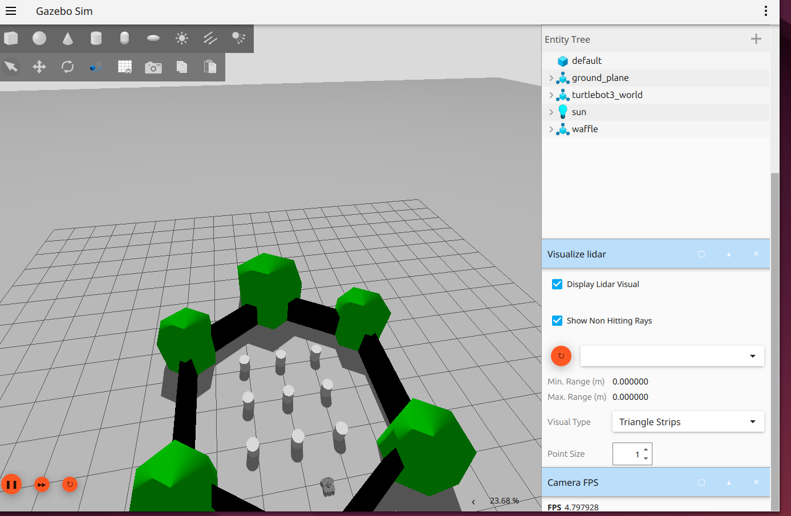
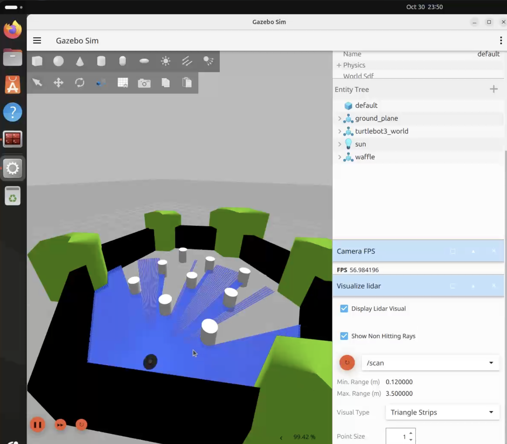
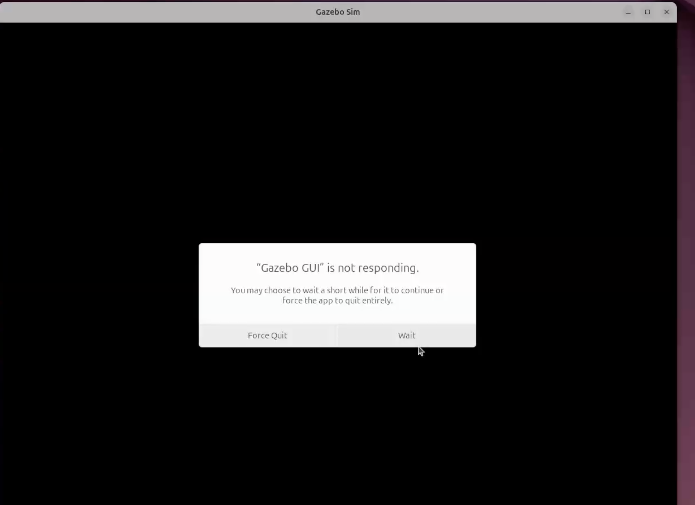

# Gazebo on Parallels: hardware-accelerated rendering on Apple silicon

A rendering workaround encountered while developing [Dum-e](../README.md),
a ROS 2 robot. This folder covers **Gazebo Harmonic on Ubuntu 24.04 ARM64,
ROS 2 Jazzy and Parallels Desktop**: startup crashes, a black or unresponsive
GUI, Ogre 2 shader errors and very low frame rates.

The installed profile uses a patched **Ogre 1** component and private
**Mesa 24.0.5**, keeping **VirGL hardware acceleration**. The normal `gz sim`
and `ros2 launch` commands use it automatically.

**[Installation guide](INSTALL.md)** ·
[Measured results](evidence/) ·
[RViz companion fix](../rviz-parallels/README.md)

## Before and after

| Low frame rate, before | Hardware rendering with the profile |
|---|---|
|  |  |

These individual frames show **4.80** and **56.98 GUI FPS**. They illustrate
the symptoms and working result from different sessions, rather than a
controlled two-frame benchmark. The original measurements reached about
**60 GUI camera updates/s**; camera sensor output and simulation real-time
factor are separate measurements in the [installation guide](INSTALL.md#status).

Another starting symptom: black screen and “Gazebo GUI is not responding”

## Tested Parallels versions

| Parallels Desktop | Gazebo version | Without this profile | Works after fix? | Evidence |
|---|---|---|---|---|
| **27.0.3 (58680)** | Harmonic / Sim **8.15.0** | Ogre 2 startup/rendering failures; low frame rates in the earlier fallback setup | **Yes.** Patched Ogre 1, private Mesa 24, hardware VirGL | [Original status](INSTALL.md#status), [measurements](evidence/) |
| **27.1.0 (58756)** | Harmonic / Sim **8.15.0** | Fragment shader compilation failure, then GUI abort | **Yes.** Existing profile renders the 3D scene | [5 November 2026 retest](retests/2026-11-05/README.md) |

Both rows refer to **one MacBook Pro M5 Max VM**, Ubuntu 24.04 ARM64,
ROS 2 Jazzy, system Mesa **25.2.8** and private Mesa **24.0.5**. The 27.1.0
retest checked rendering and recovery; it did not repeat the FPS or
sensor-accuracy benchmarks. A second clean VM has not been tested.

## Does Parallels 27.1.0 resolve the Linux rendering issue?

Not on this tested VM. The standard Ogre 2 path still fails with
`Fragment Program ... failed to compile`. Its shader log includes
`no matching function for call to texelFetch(usampler2D, int)`.

The official [Parallels release notes](https://kb.parallels.com/en/131168)
list the OpenGL application fixes under **Windows virtual machines**.
The Linux result here comes from the direct retest above.

## What this fixes

- Makes the tested Gazebo setup usable on the virtual GPU, with LiDAR and
  RGB camera output verified in the original sensor tests.
- Preserves normal CLI and ROS launch entry points, with backups and rollback.
- Keeps Mesa of the Ubuntu desktop at its installed version.

This profile uses **Ogre 1**. It does not enable Ogre 2-only features or claim
to fix every Gazebo rendering issue. RViz uses its own renderer and needs the
[separate RViz profile](../rviz-parallels/README.md) on this VM.

## Start here

1. Read the tested versions and limitations above.
2. Follow [INSTALL.md](INSTALL.md) inside the Ubuntu VM.
3. Verify the renderer and sensor output before relying on the simulation.

The [kit](kit/) contains the build/install scripts. The [overlay](overlay/)
contains the alternative source workflow. The single-row and single-column
GPU LiDAR correction was accepted upstream in
[gazebosim/gz-rendering#1400](https://github.com/gazebosim/gz-rendering/pull/1400);
that numerical fix is one part of the complete VM workaround.

## Additional reset regression validation

[Independent validation of gz-sim #4082](retests/2026-11-07-sensor-topic-reset/README.md)
covers rendering sensors losing their `SensorTopic` component after a world
reset. A diagnostic Harmonic backport preserves the metadata in six runs
across three paired comparisons. This is separate from the graphics profile and is not established
to be Parallels-specific; the installed default profile was left unchanged.
