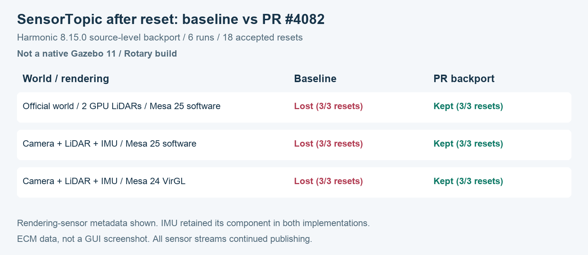

# SensorTopic after world reset: independent validation of gz-sim #4082

**Result:** a source-level backport of
[Federico Celauro's PR #4082](https://github.com/gazebosim/gz-sim/pull/4082)
onto **Gazebo Sim 8.15.0 / Harmonic** restores the rendering sensors'
`SensorTopic` components after a full world reset in the cases below.

**Scope:** this is a Harmonic backport test, **not a native Gazebo 11/Rotary
build or an approval of the complete main-branch PR**. Native configuration
stopped at the missing unversioned `gz-cmake` dependency. No packages were
installed to change that environment. The tested PR head was
`fd3794882aa647b79f2769f56b46bc8cc7ee37c7`.

## Before and after



This is a plot of recorded ECM results, not a GUI screenshot.

| World and rendering | Installed implementation | PR backport |
|---|---|---|
| Official `visualize_lidar.sdf`, stock OGRE 1, Mesa 25 software | Both GPU LiDARs lose SensorTopic on each reset | Both preserve IDs and topics after all 3 resets |
| Minimal camera + GPU LiDAR + IMU, stock OGRE 1, Mesa 25 software | Camera and LiDAR lose SensorTopic; IMU keeps it | All three preserve IDs and topics after all 3 resets |
| Same minimal world, patched OGRE 1, private Mesa 24 / VirGL | Camera and LiDAR lose SensorTopic; IMU keeps it | All three preserve IDs and topics after all 3 resets |

Six isolated runs, three accepted `reset.all` requests per run: **18 resets**.
The baseline assertion exits 1; the backport assertion exits 0 in each pair.
All six runs completed. Their sensor streams continued publishing.

This additionally covers a metadata failure: an entity lookup through
`components::SensorTopic` stops working even though the sensor still publishes.
An existing VisualizeLidar instance may retain a cached entity ID; the missing
component does not mean every reset immediately displaces an existing visual.

This is not demonstrated to be a Parallels-specific bug. It is filed here
because it was encountered while using the documented VM environment.

## Environment and isolation

7 November 2026; one Ubuntu 24.04 ARM64 VM on an Apple M5 Max, ROS 2 Jazzy
vendor packages, Sim 8.15.0, gz-rendering 8.2.3, gz-sensors 8.2.2.

The stock comparison uses OGRE 1 and system Mesa 25.2.8 with software rendering.
The hardware comparison uses the existing patched OGRE 1 / private Mesa 24.0.5
runtime. It does not require that runtime to reproduce the original bug.

Two diagnostic components were built without installing them: the rendering
library and the Sensors system plugin, linked to the installed Harmonic core
and dependencies. They were loaded only by test processes. Each run had a
unique `GZ_PARTITION`; only its own process groups were stopped. The installed
profile and libraries were not replaced. Their recorded fingerprints match
before and after. No GUI was opened for this test.

### Check which libraries actually loaded

The first assembly check loaded the new rendering library but the stock
Sensors plugin despite the plugin-path override. It still lost SensorTopic.
That attempt is excluded from the six valid comparisons.

For the complete backport runs, temporary SDF copies name the compiled Sensors
plugin by absolute path. No geometry or sensor settings change.
`/proc/<pid>/maps` confirms both diagnostic libraries loaded. The published
checker verifies these paths; it does not infer success just from environment
variables.

## Evidence

- [Machine-readable summary](evidence/summary.json).
- [Raw ECM states, per-run JSON, server logs and loaded-library maps](evidence/raw-ecm-and-logs.tar.gz).
- [Component build log](evidence/component-build.log) and [native preflight failure](evidence/native-configure.log).
- [Backport patch](backport/harmonic-backport.patch), [origin and adaptation](backport/ORIGIN.md), [upstream file hashes](backport/upstream-files.sha256).
- [Profile fingerprints before](evidence/profile-fingerprint.before.txt) and [after](evidence/profile-fingerprint.after.txt).

Inspect the recorded results without starting Gazebo:

```bash
python3 scripts/verify_evidence.py
```

The minimal world's central ray remains approximately 2.000001 m against a
wall 2 m away. Camera messages are 64 x 48, with 9,216 bytes. These checks and
message counts are not a full range-accuracy, pixel-quality or FPS benchmark.
The PR's ghost-visual scenarios and C++ integration suite were not tested here.

## Build the diagnostic backport

Requires an existing Harmonic 8.15.0 development environment, CMake, a C++17
compiler, curl, patch and the gz-transport13 / gz-msgs10 Python bindings for
the probe. The scripts do not install dependencies or change shell profiles.

From this directory, inside the reference ROS Jazzy VM:

```bash
source /opt/ros/jazzy/setup.bash
bash scripts/build_harmonic_overlay.sh /tmp/gz4082-harmonic-test
```

The destination must not already exist. The script downloads six source files
from the pinned 8.15.0 tag, verifies their hashes, applies the backport and
builds with one worker at reduced priority. It never runs `cmake --install`.
The reduced [CMake project](backport/CMakeLists.txt) builds the same rendering
translation units and Sensors translation unit used by the measured test.

## Reproduce the comparison

These commands target the reference Jazzy vendor layout. Adapt SDK paths on
other installations. The probe preserves an existing transport/display
configuration where specified below; its recorded defaults reflect the tested
VM. Use a dedicated display if your system needs a different X authority.

Set paths in the terminal used for the test:

```bash
BASE=/tmp/gz4082-harmonic-test
WORLD=/opt/ros/jazzy/opt/gz_sim_vendor/share/gz/gz-sim8/worlds/visualize_lidar.sdf
ENGINE=/opt/ros/jazzy/opt/gz_rendering_vendor/lib/libgz-rendering8-ogre.so
ORIGINAL_GZ=/opt/ros/jazzy/opt/gz_tools_vendor/bin/gz.vendor
```

`gz.vendor` is the original entry point preserved by the VM profile. On a
normal installation without that wrapper, omit `--gz ruby "$ORIGINAL_GZ"`
to use the default `gz` entry point instead.

Baseline, with no diagnostic library overrides:

```bash
env -u LD_PRELOAD -u GZ_SIM_SYSTEM_PLUGIN_PATH LP_NUM_THREADS=1 \
  python3 scripts/probe_v2.py --label baseline --expected-count 2 \
  --world "$WORLD" --engine "$ENGINE" --software --resets 3 \
  --expect-preserved --out "$BASE/results-baseline" \
  --gz ruby "$ORIGINAL_GZ"
```

Expected exit: **1**, with both SensorTopic components absent after reset.
Use a clean shell without an inherited overlay in `LD_LIBRARY_PATH`.

Create a fresh SDF copy and run the backport:

```bash
python3 scripts/prepare_world.py --source "$WORLD" \
  --plugin "$BASE/build/overlay/plugins/libgz-sim8-sensors-system.so" \
  --output "$BASE/official-patched.sdf"

env -u LD_PRELOAD LP_NUM_THREADS=1 \
  LD_LIBRARY_PATH="$BASE/build/overlay/lib:$LD_LIBRARY_PATH" \
  python3 scripts/probe_v2.py --label patched --expected-count 2 \
  --world "$BASE/official-patched.sdf" --engine "$ENGINE" \
  --software --resets 3 --expect-preserved --out "$BASE/results-patched" \
  --gz ruby "$ORIGINAL_GZ"
```

Expected exit: **0**. Inspect `*-loaded-libraries.txt` to confirm both overlay
components loaded. Exit **2** means an incomplete probe, not a failed metadata
assertion. Initial state must contain the expected sensor count and topics;
after reset the probe compares the full ID-to-topic map.

For the camera/LiDAR/IMU test, substitute `reset-metadata.sdf` and use
`--expected-count 3`; prepare a separate patched copy in the same way. The
optional `--private-mesa` flag refers to the private runtime path of the
reference VM and is only useful where that profile already exists.

The receiver runs in a separate process from transport service requests.
The probe uses temporary files and terminates only processes it created.
It does not modify installed libraries, send commands to other partitions,
or turn this diagnostic overlay into a default runtime.
