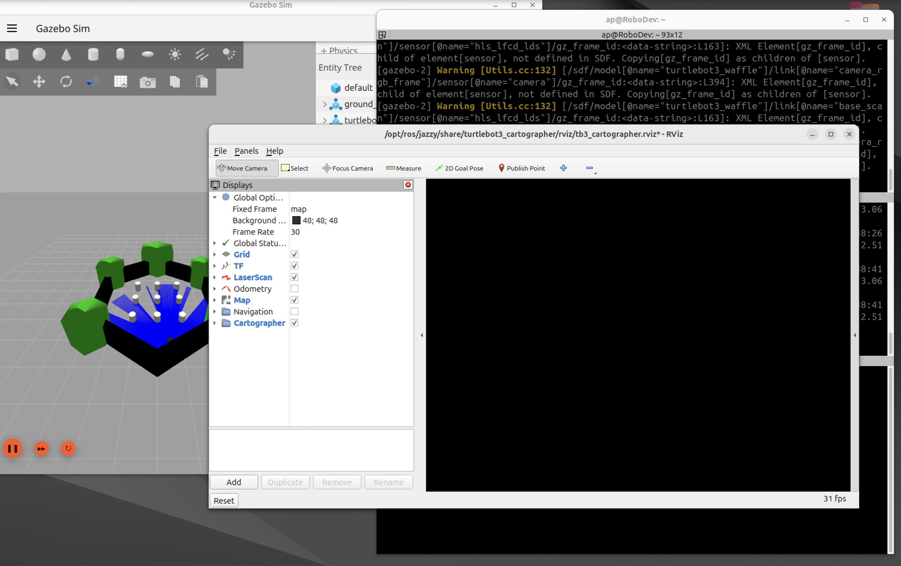

# RViz 2 black screen on Parallels: hardware-accelerated viewport with private Mesa

Ubuntu 24.04 ARM64, ROS 2 Jazzy, RViz 14.1.24. Tested with Parallels Desktop
**27.0.3 (58680)** and **27.1.0 (58756)** on Apple silicon.

See the [tested Parallels versions and before/after results](#tested-parallels-versions).
The RViz black viewport persists with system Mesa 25.2.8 on both tested
versions; the private Mesa 24.0.5 profile restores hardware rendering.

On the same VM where the [Gazebo kit](../gazebo-parallels/INSTALL.md) runs at 60 fps, RViz 2
opens with a black viewport: the grid, the robot model and the map never
appear. This optional add-on makes the packaged `rviz2` load the private Mesa
24.0.5 runtime already installed by the Gazebo kit, so RViz renders on the
virtual GPU. Nothing else changes: same RViz binary, same OGRE 1.12.10, no new
packages, no system Mesa downgrade.

## The symptom



The rendering area is black even though the configured background is gray
and the Grid display is enabled. The screenshot illustrates the original
symptom; the working accelerated result is documented by the driver logs
and visual confirmations in [evidence](evidence/).

## Tested Parallels versions

| Parallels Desktop | RViz version | Without this profile | Works after fix? | Evidence |
|---|---|---|---|---|
| **27.0.3 (58680)** | Jazzy / RViz **14.1.24**, Ogre **1.12.10** | System Mesa 25.2.8: black viewport | **Yes.** Private Mesa 24.0.5, hardware VirGL; grid and Cartographer map visible | [4 November 2026 checks](evidence/results.json) |
| **27.1.0 (58756)** | Jazzy / RViz **14.1.24**, Ogre **1.12.10** | System Mesa 25.2.8: black or empty viewport | **Yes.** Existing profile renders the synthetic map | [5 November 2026 retest](../gazebo-parallels/retests/2026-11-05/README.md) |

Both rows cover the same M5 Max / Ubuntu 24.04 ARM64 VM. The owner confirmed
that Parallels was updated after the first RViz check. No dedicated RViz FPS
benchmark or second clean-VM reproduction is claimed.

## Status

| Item | Value |
|---|---|
| Verified on | the Gazebo kit VM (MacBook Pro M5 Max, Ubuntu 24.04.5 ARM64). Initial RViz check: Parallels 27.0.3 (58680), 4 November 2026. Retest: Parallels/Tools 27.1.0 (58756), 5 November 2026. |
| Packages | ros-jazzy-rviz2 14.1.24-1noble.20260916.104902, OGRE 1.12.10, system Mesa 25.2.8 |
| Result | grid and Cartographer map visible, `GL_RENDERER = virgl (Apple M5 Max (Compat))`, OpenGL 4.0, FSAA 4 |
| Scope | `rviz2`, `ros2 run rviz2 rviz2` and any `ros2 launch` that starts the packaged Jazzy RViz |

Not covered: RViz built from source in another workspace, other RViz, Ubuntu
or Mesa versions, a plugin-by-plugin certification, an RViz frame-rate
benchmark. This is a driver-version workaround verified on one VM; it does not
identify the Mesa commit that regressed.

The initial Parallels version was confirmed by the VM owner after the test;
the 27.1.0 host/Tools versions and stock/profile comparison are captured in
the [retest record](../gazebo-parallels/retests/2026-11-05/README.md).

## What was measured

| Test | Observation |
|---|---|
| System Mesa 25 / VirGL, normal launch | black viewport, reproduced after restart |
| System Mesa 25 / VirGL, OpenGL 2.1 override | black viewport |
| System Mesa 25 / VirGL, antialiasing disabled | gray, then black viewport |
| Private Mesa 24 / VirGL, antialiasing disabled | grid and map visible |
| Private Mesa 24 / VirGL, normal antialiasing | grid and map visible |

Raw OGRE logs, the installation record and the restore test are in
[evidence](evidence/). The successful run maps the private
`virtio_gpu_dri.so` and `libGLX_mesa.so.0` in the RViz process. The shader
warning `active samplers with a different type refer to the same texture image
unit` also appears in the working software-rendered control, so it is not the
cause of the black viewport. An early, unlabeled Mesa 24 trial was discarded
because several windows were open; only the titled comparison above counts.
These checks are separate from the Gazebo 53-trial ablation and do not change
that count.

## What it changes, and what it does not

The installer:

1. backs up both packaged RViz executables, `/opt/ros/jazzy/bin/rviz2` and
   `/opt/ros/jazzy/lib/rviz2/rviz2`, under `/var/backups/rviz-virgl-defaults/<UTC timestamp>/`;
2. registers a local `dpkg-divert` for each, so the originals stay next to
   them with a `.distrib` suffix and future package updates land there;
3. puts the same 14-line wrapper (`rviz2-wrapper.sh`) at both entry points.
   The wrapper prepends the private Mesa to `LD_LIBRARY_PATH`, sets
   `LIBGL_DRIVERS_PATH`, and executes the original binary with all arguments;
4. writes `/usr/local/lib/rviz-virgl-defaults/manifest.json` (package version,
   hashes, backup location) and copies `manage.py` next to it;
5. installs `/usr/local/sbin/rviz-virgl-defaults-rollback`.

Not touched: system Mesa, `/etc/ld.so.preload`, shell startup files, the
Gazebo profile, RViz configurations, models. The environment change lives in
the RViz process and its children only.

Gates: the installer refuses an RViz package other than the tested version, an
executable whose hash differs, an existing diversion, and private Mesa files
whose hashes differ from the tested runtime. If a gate stops you, the
combination is untested: revalidate it, do not remove the check.

## Requirements

- The Gazebo kit installed and verified ([INSTALL.md](../gazebo-parallels/INSTALL.md), sections
  1 to 7). The add-on needs its private Mesa at
  `/usr/local/lib/gazebo-virgl-defaults/runtime-v2/mesa`.
- ROS 2 Jazzy and `ros-jazzy-rviz2` from the official packages.
- A Parallels snapshot of the VM before you start.

Everything below runs inside the Ubuntu VM.

## 1. Check the starting point

```bash
source /opt/ros/jazzy/setup.bash
dpkg-query -W -f='${Version}\n' ros-jazzy-rviz2        # 14.1.24-1noble.20260916.104902
ls /usr/local/lib/gazebo-virgl-defaults/runtime-v2/mesa/dri/virtio_gpu_dri.so   # must exist
sha256sum /opt/ros/jazzy/bin/rviz2 /opt/ros/jazzy/lib/rviz2/rviz2
# both: 8c1b6d120d0bb89d546350d8ed031b2c3df7d15b4f4f8373f7a67310a0e74261
```

If the version or a hash differs, stop here: `manage.py` will refuse to
install, and that is the intended behaviour.

## 2. Reproduce the symptom (optional, 30 seconds)

With a simulation running, or even without one:

```bash
rviz2
```

Expected before the fix: the RViz window opens, the panels work, the 3D
viewport stays black. Close it. If your viewport is already fine, you do not
need this add-on.

## 3. Update the checkout

The kit was cloned to `$HOME/dum-e` in INSTALL.md, section 4:

```bash
cd "$HOME/dum-e"
git pull
ls rviz-parallels        # README.md  manage.py  rviz2-wrapper.sh  verify.launch.py  evidence/
```

## 4. Preflight

Read-only, changes nothing:

```bash
cd "$HOME/dum-e"
source /opt/ros/jazzy/setup.bash
python3 rviz-parallels/manage.py --check
```

Expected: `Preflight passed. No changes made. Two RViz entry points will use private Mesa.`
Any line starting with `STOP:` names the gate that failed.

## 5. Install

Close every RViz window first. Gazebo and other nodes can keep running.

```bash
cd "$HOME/dum-e"
sudo python3 rviz-parallels/manage.py --install
```

Expected: `RViz profile installed. Backup: /var/backups/rviz-virgl-defaults/<timestamp>`.
If the install fails after a diversion was registered, it removes the wrappers
and restores the original entry points by itself; the backup stays.

## 6. Verify

Open a new terminal.

```bash
source /opt/ros/jazzy/setup.bash
rviz2
```

Expected: grid visible, viewport responsive. For the full picture, with the
TurtleBot3 world from INSTALL.md, section 7, already running:

```bash
source /opt/ros/jazzy/setup.bash
sudo apt install ros-jazzy-turtlebot3-cartographer
ros2 launch turtlebot3_cartographer cartographer.launch.py use_sim_time:=true
```

This starts Cartographer and RViz together: the map builds as the robot moves.
Start only one Cartographer for a simulation.

Proof that the GPU is doing the work, not just that a window opened:

```bash
pgrep -a -f '[r]viz2.distrib'                 # the PID of the real RViz binary
grep -E 'mesa/|dri/' /proc/<PID>/maps | head  # paths under gazebo-virgl-defaults/runtime-v2/mesa
```

A reproducible RViz-only launch check, with the OGRE log written in the
current directory, while Gazebo and Cartographer are already running:

```bash
mkdir -p /tmp/rviz-check && cd /tmp/rviz-check
source /opt/ros/jazzy/setup.bash
ros2 launch "$HOME/dum-e/rviz-parallels/verify.launch.py"
# in another terminal, after the window opens:
grep -E 'GL_RENDERER =|GL_VERSION =|FSAA=' /tmp/rviz-check/Ogre.log
```

Expected: `GL_RENDERER = virgl (...)`, `GL_VERSION = 4.0`, `FSAA=4`. The launch
starts RViz only, with the packaged TurtleBot3 Cartographer display and
simulation time; pass `rviz_config:=/absolute/path/to/config.rviz` for another
layout. A grid proves rendering; a map also needs its publishers and TF. A
missing-map or TF warning after Cartographer was stopped is not a graphics
failure.

## 7. Everyday use

Nothing to type: `rviz2`, `ros2 run rviz2 rviz2` and your launch files pick up
the wrapper. To see what is installed:

```bash
python3 /usr/local/lib/rviz-virgl-defaults/manage.py --status
```

`RVIZ_VIRGL_DEFAULTS=0 rviz2` runs one RViz with the system driver, for
diagnostics (black viewport expected). An RViz already open is not affected by
installing, bypassing or rolling back: close it and start it again to compare.

After an RViz, ROS, Parallels or Mesa update, repeat section 6: `dpkg-divert`
routes package updates to the `.distrib` binaries, but nothing checks that a
new RViz still works with Mesa 24.0.5.

## 8. Rollback

Close RViz, then:

```bash
sudo /usr/local/sbin/rviz-virgl-defaults-rollback
```

It validates both wrappers and diversions, removes the diversions and puts the
current packaged executables back. The profile directory is archived with a
timestamp; the backups in `/var/backups/rviz-virgl-defaults/` stay. Restore
and reinstall were tested on the VM (`evidence/rollback-reinstall.txt`).

Roll this add-on back before removing the Gazebo private runtime: the wrapper
refuses to start RViz if the Mesa files are gone. Rolling back the Gazebo
delegates alone (INSTALL.md, section 10) leaves the runtime on disk, so RViz
keeps working.

## Troubleshooting

| Symptom | What to check |
|---|---|
| `STOP: Untested RViz package` | A different `ros-jazzy-rviz2` version. Not covered; do not bypass. |
| `STOP: Install the Gazebo private runtime first` | INSTALL.md sections 4 to 6 not done, or the runtime was removed. |
| `STOP: An RViz profile already exists` | Already installed. `manage.py --status` to inspect, rollback to redo. |
| Viewport still black after install | An old RViz window: close and restart. Then check `/proc/<PID>/maps` for `runtime-v2/mesa`. |
| `RViz private Mesa runtime missing` at start | The Gazebo runtime was removed with the add-on still installed. Roll back the add-on. |
| Grid visible, no map | Not a graphics problem: check Cartographer is running and TF is published. |

## Files

- `manage.py`: preflight (`--check`), `--install`, `--status`, `--rollback`.
- `rviz2-wrapper.sh`: the wrapper placed at both entry points.
- `verify.launch.py`: optional RViz-only launch check.
- `evidence/`: OGRE logs for each driver combination, installation record,
  restore test.

## Credits and license

RViz, OGRE and Mesa keep their own licenses; this add-on redistributes none of
their code or binaries. Scripts and this document: Apache-2.0, Alessandro
Pistella.

## Optional: a visible map that becomes distorted

A black viewport and a distorted SLAM map are different problems. For the
TurtleBot3 house case, see the experimental [Cartographer house add-on](addons/cartographer-house/README.md).
It contains a separate mapping profile, four replay comparisons, an independent
live validation and evidence-collection instructions. Its optional managed
default covers the packaged TurtleBot3 profile. The addon does not change the
RViz/Mesa fix described above. Settings intended for Dum-e itself live under
[robot configuration](../config/workarounds/cartographer/README.md).
