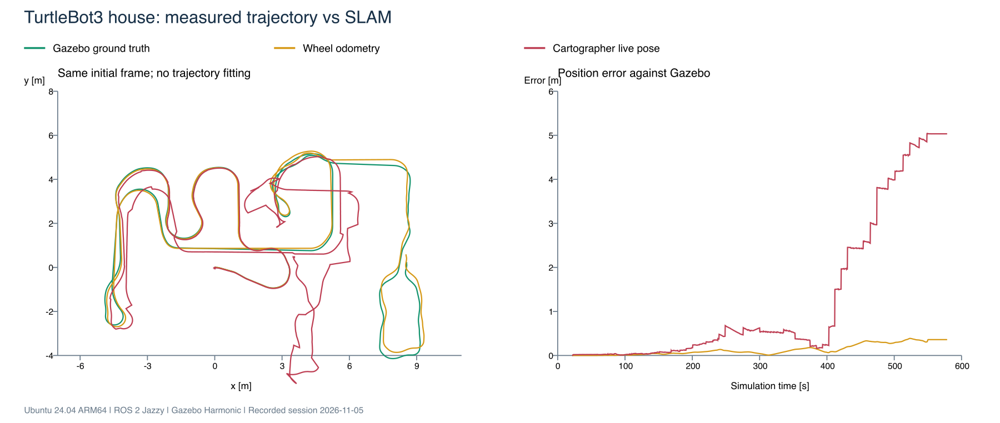
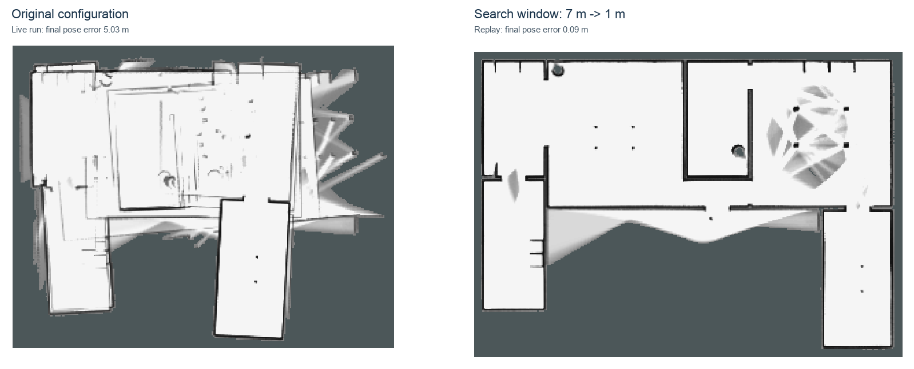
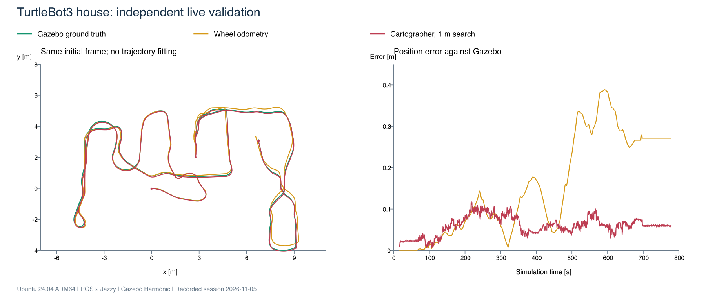
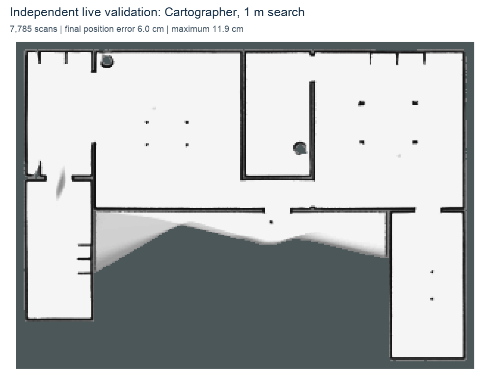

# Cartographer house investigation: method, controls and results

Measurements from 5 November 2026. This report concerns map estimation after
the viewport already renders correctly. It is separate from the Gazebo/Mesa
and RViz black-viewport workarounds and from the earlier 53 rendering trials.

## Question and conclusion

The map developed overlapping walls, especially when entering the far room.
The initial question was whether incorrect GPU LiDAR distances caused it.

The recorded data instead isolate the multi-meter distortion to global SLAM
associations: replaying the original settings reproduces it; disabling global
optimization removes it; reducing only the translational search window from
7 m to 1 m retains optimization and prevents the large error on that route.
A second, independently driven live route confirms the selected setting.

This is evidence for a configuration/association failure on this setup. It is
not a demonstrated Cartographer implementation bug, a universal parameter
recommendation, or proof that rendering drivers can never affect sensors.

## Environment and controls

| Item | Value |
|---|---|
| Host / VM | MacBook Pro M5 Max, Parallels Desktop/Tools 27.1.0 (58756), Ubuntu 24.04 ARM64 |
| ROS / simulator | ROS 2 Jazzy, Gazebo Harmonic, gz-sim 8.15.0 |
| TurtleBot3 Gazebo | `2.3.7-1noble.20261006.044322` |
| TurtleBot3 Cartographer | `2.3.6-1noble.20260921.052917` |
| Cartographer ROS | `2.0.9003-2noble.20260921.043215` |
| RViz | `14.1.24-1noble.20260916.104902` |
| Robot / world | Packaged Waffle, `turtlebot3_house` |
| LiDAR | 360 rays, 10 Hz, range 0.12–3.5 m, Gaussian noise sigma 0.01 m |
| Reference config | `use_odometry=true`, `use_imu_data=false`, `use_sim_time=true`, match `min_score=0.65` |
| Graphics | Existing OGRE 1 / private Mesa 24.0.5 profile; unchanged during the experiments |

The source TurtleBot3 Lua SHA-256 was
`5e9619c353726157b30dd0e3fdbc6dc1fd134494f19ab2560979af309030de4b`.
The Waffle model SHA-256 was
`accd90e78a5f8b77f0909cfd662be06a26c3eb96c6719c039f80392788470184`.
The house visual-model SDF SHA-256 was
`d3159d9a357b62fb5794301a641fba40f4f47e302033988115a67df9db82fc33`.
The house world file SHA-256 was
`700013da999368ad97bb1782612fcf81097196d09ee95ac36249a6afbcb5a06c`.

Live graph inspection found one scan publisher and one odometry publisher,
both from `ros_gz_bridge`. TF ownership was split normally between the bridge,
robot-state publisher and Cartographer. The scan and odometry logs reported
10 and 50 Hz respectively. There was no sustained Cartographer queue backlog
in the inspected logs. These observations do not constitute a latency benchmark.

## Ground truth and error definition

Gazebo's `/world/default/dynamic_pose/info` supplies the Waffle model pose.
It is recorded independently as JSONL and as pose-only Odometry on
`/debug/gazebo_ground_truth`. The zero/default twist and covariance fields
are not measurements. No debug TF or robot commands are published.

For this Waffle, model origin and ROS `base_footprint` coincide in XY. The
known initial world pose, approximately `(-2, -0.5, yaw=0)`, defines the common
frame. Ground truth is translated and rotated by this initial transform;
there is **no best-fit trajectory alignment**.

At each sampled `map -> odom` timestamp, wheel odometry and ground truth are
interpolated to that time. Live SLAM pose is reconstructed as:

```text
T_map_base(t) = T_map_odom(t) * T_odom_base(t)
position_error(t) = norm(position_map_base(t) - position_ground_truth(t))
```

`map -> odom` is sampled approximately every 0.1 s. Heading interpolation uses
unwrapped angles; reported heading errors are wrapped to ±180 degrees. RMS,
maximum, final and percentile errors use the overlapping pose interval.
These are live-pose errors, not the retrospectively optimized historical path.

The [analysis script](analyze_bag.py) was run against both original MCAP bags.
Its results agree with the earlier array-based analysis to numerical precision.
The public profile generator was also checked after default integration;
the public ground-truth recorder captured 143 valid poses in isolated domain
93. The public wall-check script reproduced the validation-route range
statistics. See [script checks](evidence/script-checks.json).

## Preliminary stationary and motion checks

A 25 s observation acquired 248 scans, with 360 rays each. Scan timestamps
were spaced by 0.1 simulated seconds, with no NaN ranges. The robot was
stationary according to both Gazebo and odometry; range noise was about 1 cm.

Comparing the median of those scans with 94 visual boxes in the house gave:

| Stationary check | Result |
|---|---:|
| Comparable ray directions | 252 |
| Median absolute range error | 0.69 mm |
| 95th percentile absolute range error | 4.62 mm |
| Directions within 4 cm | 248 / 252 |

The sub-millimeter figure is for **temporally median-filtered** measurements,
not instantaneous sensor accuracy. Four directions near the scan wrap and a
close obstacle differed by up to 12 cm. They were not silently counted as
correct and remain an unresolved close-range detail.

A separate motion observation compared matched time intervals: Gazebo
rotation 102.61 degrees versus odometry 102.97 degrees; traveled distances
0.168 m versus 0.152 m. This ruled out a gross scale error in that maneuver,
not all possible odometry drift.

## Original live route

The reference recording contains 5,780 scans over 577.9 simulated seconds
(605.15 wall-clock seconds). It includes 28,895 odometry messages and 34,576
ground-truth poses. The pose-error interval is 22.125–577.882 s.

| Metric | Live Cartographer | Wheel odometry |
|---|---:|---:|
| Final position error | 5.034 m | 0.360 m |
| Maximum position error | 5.043 m | 0.388 m |
| RMS position error | 2.154 m | 0.180 m |
| Median position error | 0.480 m | 0.084 m |
| 95th percentile position error | 5.033 m | 0.360 m |

Live SLAM first exceeded 1 m error at simulated time 411.830 s and 2 m at
430.406 s. Large increases aligned with global optimization updates. This
correlation motivated the replay controls; by itself it was not proof.



Numerical data: [summary](evidence/reference-live-summary.json),
[sampled trajectory](evidence/reference-live-trajectory.csv.gz).

## Replay ablation on the same recording

Input contained scan, odometry, IMU, clock, and dynamic/static TF. Recorded
`map -> odom` transforms were removed to prevent feedback from the old SLAM
result. Clock messages were reduced to approximately 100 Hz. Four separate
ROS domains, 87–90, isolated the trials from the live simulation. No velocity
commands were replayed. Playback rate was 3x, with processing allowed to finish.

| Trial | Only changed setting | Final error | Maximum | RMS |
|---|---|---:|---:|---:|
| Baseline | None | 5.395 m | 5.396 m | 2.189 m |
| Diagnostic control | `POSE_GRAPH.optimize_every_n_nodes=0` | 0.193 m | 0.204 m | 0.125 m |
| Selected candidate | `fast_correlative_scan_matcher.linear_search_window=1.0` | **0.090 m** | **0.118 m** | **0.075 m** |
| Alternative | `constraint_builder.min_score=0.80` | 0.327 m | 0.345 m | 0.182 m |

The last two options are under `POSE_GRAPH.constraint_builder`. All other
settings remain at the reference values. The original window was 7 m; the
original acceptance score was 0.65. Disabling optimization was a diagnostic
control, not the deployed solution.

The baseline replay reproduces the failure but is not bit-identical to the
live run: asynchronous processing, playback rate and optimization timing can
change the result. Reported numbers distinguish live and replay explicitly.



Per-sample replay data: [baseline](evidence/replay-baseline-trajectory.csv.gz),
[optimization off](evidence/replay-no_global-trajectory.csv.gz),
[1 m window](evidence/replay-tight_window-trajectory.csv.gz),
[score 0.80](evidence/replay-strict_score-trajectory.csv.gz).

## Independent live validation

A fresh simulation and trajectory used the selected profile. The operator
drove another route, including the previously problematic area, and reported
that the final map looked excellent. This is an additional route on the same
VM, not a clean-VM reproduction or a controlled repeat of identical motion.

The recording contains 7,785 scans, 38,924 odometry messages and 47,175
ground-truth poses. Duration is 778.48 simulated seconds / 844.776 wall-clock
seconds. The pose-error interval is 16.383–778.407 s, with 7,803 samples.

| Metric | Live Cartographer, 1 m search | Wheel odometry |
|---|---:|---:|
| Final position error | **0.060 m** | 0.271 m |
| Maximum position error | **0.119 m** | 0.389 m |
| RMS position error | **0.064 m** | 0.196 m |
| Median position error | 0.060 m | 0.124 m |
| 95th percentile position error | 0.097 m | 0.346 m |

Final SLAM heading error was 0.188 degrees. Maximum absolute instantaneous
heading error was 6.347 degrees; the result is not a claim of perfect pose
accuracy during every turn. The reference live run's corresponding values
were −3.044 and 6.057 degrees.

Both recordings contain zero NaN scan ranges. Header intervals range from
0.098 s to approximately 0.100 s; there are no large scan gaps in these bags.





Numerical data: [summary](evidence/validation-live-summary.json),
[sampled trajectory](evidence/validation-live-trajectory.csv.gz).

Two other starts were excluded: one was interrupted during setup when an
old server was found, and one ended in an operator-reported collision after
Caps Lock affected keyboard control. Their recordings were retained locally
and labeled interrupted, not counted as successful or failed tuning trials.

## LiDAR geometry cross-check during both routes

Every tenth scan was checked against analytic ray/box intersections using
the house's visual geometry and nearest-time Gazebo pose, including robot
roll/pitch and sensor offset `(-0.064, 0, 0.121)` m. Range comparisons use
predicted wall hits strictly between 0.30 and 3.40 m and finite returns.

| Quantity | Original route | Independent validation |
|---|---:|---:|
| Sampled scans | 578 | 779 |
| Comparable wall rays | 131,457 | 185,330 |
| Median of per-scan median absolute range error | 6.98 mm | 7.03 mm |
| Largest per-scan median absolute range error | 9.03 mm | 9.71 mm |
| Compared rays within 5 cm | 98.35% | 97.31% |

The instantaneous errors are consistent with 10 mm configured Gaussian noise.
They do not show a generalized range failure when the map begins to collapse.
The smaller percentage within 5 cm does not mean every other return is wrong:
mesh/cylinder occluders were excluded from the analytic geometry and can
produce legitimate returns closer than the predicted wall. Surface edges,
nearest-pose synchronization and near-clip behavior are additional limitations.
Near-wrap rays below 0.30 m and all mesh surfaces remain outside this check.

Per-scan results: [original](evidence/reference-wall-check.csv.gz),
[validation](evidence/validation-wall-check.csv.gz). These compact results
allow checking the aggregate table; full ray reprocessing requires the raw
recording and geometric analysis, not just these summaries.

The [wall-check script](validate_wall_ranges.py) implements the analytic
comparison. Run it with a finalized bag and the recorded model version:

```bash
source /opt/ros/jazzy/setup.bash
python3 validate_wall_ranges.py \
  --bag /path/to/finalized/bag \
  --model /opt/ros/jazzy/share/turtlebot3_gazebo/models/turtlebot3_house/model.sdf \
  --output /path/to/wall-analysis
```

Its fixed sensor offset and wall-name classification are specific to this
Waffle/house check. Adapt and revalidate them for another model.

## Why this is not attributed to the graphics workaround

Graphics settings did not change between baseline, controls and selected
candidate. The global-SLAM failure can be reproduced offline from already
recorded scans, without rerendering them. Retaining the same sensor input
and changing one association-search parameter prevents the large distortion.

That supports a global map-association/configuration explanation. It does
not establish an upstream code defect or rule out every localized rendering
issue. There is no equivalent hardware-accelerated OGRE 2 counterfactual on
this VM. The four close-range ray discrepancies remain separately documented.

## Default integration and rollback verification

After the independent route, the tested setting was made the default for the
packaged TurtleBot3 2D Lua configuration only. A local `dpkg-divert` preserves
the packaged file as `.distrib`; the replacement includes it and overrides
one setting. Cartographer's shared defaults, models, drivers and custom robot
profiles are unchanged.

Verification covered:

1. A Lua assertion on the effective
   `options.map_builder.pose_graph.constraint_builder.fast_correlative_scan_matcher.linear_search_window`
   passed with value `1.0` through the include-based overlay.
2. Install, rollback, exact source SHA-256 restoration, then reinstall passed.
3. The normal TurtleBot3 launch without configuration overrides loaded the
   packaged original and started a trajectory in isolated domain 91. RViz was
   disabled for that startup check. This was not another full mapping run.

Receipts: [installation](evidence/default-installation.json),
[normal launch](evidence/default-launch-check.json). The script is version/hash
gated and exposes source changes after APT updates through its status output.
An updated packaged source requires revalidation.

## Reproduce the pose measurements and retain the evidence

Inside a sourced Jazzy environment:

```bash
python3 analyze_bag.py --bag /path/to/finalized/bag --output /path/to/analysis
```

The tool emits the same JSON schema and compressed trajectory CSV used here.
Start recording before robot motion. For replay experiments, remove original
map-to-odom TF, isolate ROS domains, keep recorded timestamps and static TF,
and compare variants on the same sensor recording.

Raw bags are retained locally, outside Git. They are not currently public;
therefore complete independent SLAM replay requires obtaining those recordings.
The compact pose/range results and configuration are included for inspection.

| Raw MCAP file | SHA-256 |
|---|---|
| Reference | `79cf33cd1fbba62298699188083a7a88d6ea540e4ce88c3f9a7359f59969edea` |
| Independent validation | `5fb01c91cc9ae716b50409f1aea588ef99d296ff5cc3ee3ff57ada06405cd02f` |

## Remaining limits

One machine, one robot model and one world, with two usable live routes and
four reference replays. No physical Dum-e validation, 3D Cartographer tuning,
automatic false-loop-closure detector, new-VM reproduction or universal
1 m setting is claimed. A narrower window can reject true matches when the
pose prior has drifted too far. Use the [Dum-e configuration procedure](../../../config/workarounds/cartographer/README.md)
to choose and measure a setting for another robot.

The diagnostic separation follows the upstream
[Cartographer tuning methodology](https://google-cartographer-ros.readthedocs.io/en/latest/tuning.html),
which recommends isolating local/global SLAM and verifying tuned parameters
on additional recordings.
