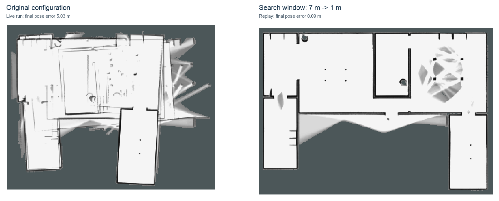
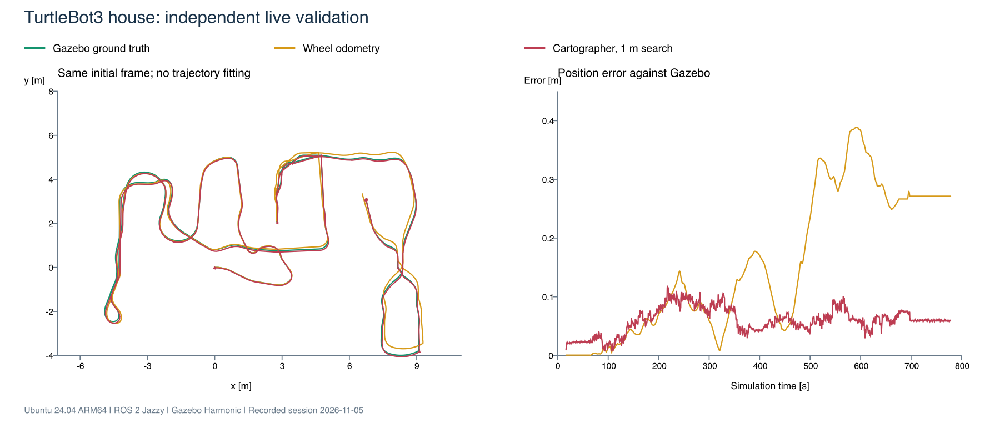

# TurtleBot3 house: distorted Cartographer map despite a working RViz viewport

**Mapping add-on measured on TurtleBot3 house.** This addresses Cartographer's map alignment,
not RViz rendering, Mesa, or a general Gazebo LiDAR defect. It lives beside
the RViz guide because the symptom appears in RViz while studying TurtleBot3.
The user-level profile changes no installed files. A separate, opt-in managed
default changes one packaged TurtleBot3 configuration, with backup and rollback.



## Before and after: metres of error reduced to centimetres

Ubuntu 24.04 ARM64, ROS 2 Jazzy, Gazebo Harmonic, TurtleBot3 Waffle and the
packaged `turtlebot3_house` world. One MacBook Pro M5 Max / Parallels VM.
The recording contains 5,780 scans over approximately 578 simulated seconds.
Both columns replay those same sensor measurements and compare the estimated
robot position with independent Gazebo ground truth.

**Final position error: 5.395 metres before → 9.0 centimetres after.**

| Position error against ground truth | Before: original 7 m search | After: selected 1 m search |
|---|---:|---:|
| Final | **5.395 m** | **9.0 cm** |
| Maximum during the route | 5.396 m | 11.8 cm |
| RMS over the route | 2.189 m | 7.5 cm |

Only the loop-closure translation search window changes, from 7 m to 1 m.
Global optimization remains enabled in both columns.

### Diagnostic controls and alternative

These additional trials helped isolate the cause. The deployed profile is
the 1 m search above.

| Additional trial on the same recording | Final error | Maximum error | RMS error |
|---|---:|---:|---:|
| Global optimization disabled, diagnostic control | 19.3 cm | 20.4 cm | 12.5 cm |
| Match acceptance score raised from 0.65 to 0.80 | 32.7 cm | 34.5 cm | 18.2 cm |

Each trial changes one parameter. Replays run at 3x in isolated ROS domains,
with recorded `map -> odom` transforms removed. Ground truth comes directly
from Gazebo model poses, with the initial world pose used as the common frame;
the trajectories are not fitted to one another. These are live-pose errors,
not errors of the retrospectively optimized trajectory.

Across 578 sampled scans, the median wall-range error remains about 7 mm,
consistent with the configured 10 mm noise standard deviation. The geometric
check covers predicted wall hits from 0.30 to 3.40 m. It does not certify all
mesh surfaces or close-range rays. Four near-wrap rays with discrepancies
up to 12 cm were found in an earlier close-obstacle check and remain separate.

The evidence points to incorrect global map associations on this route.
The narrower search retains global optimization. It can also reject valid
loop closures if drift exceeds the search window, so **1 m is not a universal
recommendation** for other robots or environments.

### Independent live confirmation

A new live route with **7,785 scans** confirmed the selected profile:
**6.0 cm final position error**, **11.9 cm maximum** and **6.4 cm RMS**.
The original live route ended at **5.034 m**; these two live routes have
different motion. The paired before/after table above uses identical recorded
input. See the full [method, controls, measurements and limitations](MEASUREMENTS.md)
and [machine-readable results](evidence/results.json).



## Generate the optional profile

Run inside the Ubuntu VM from this directory:

```bash
source /opt/ros/jazzy/setup.bash
python3 prepare_profile.py
```

The script copies the installed TurtleBot3 configuration into your home
directory and inserts only:

```lua
POSE_GRAPH.constraint_builder.fast_correlative_scan_matcher.linear_search_window = 1.0
```

It records source/output hashes and refuses to replace a different existing
profile. Review the source if the packaged configuration changes. Start a
fresh house simulation and a fresh Cartographer trajectory:

```bash
export TURTLEBOT3_MODEL=waffle
ros2 launch turtlebot3_gazebo turtlebot3_house.launch.py
```

In another terminal:

```bash
source /opt/ros/jazzy/setup.bash
ros2 launch turtlebot3_cartographer cartographer.launch.py \
  use_sim_time:=true \
  cartographer_config_dir:="$HOME/.local/share/dum-e/cartographer-house" \
  configuration_basename:=turtlebot3_house_2d.lua
```

To return to the packaged configuration, close Cartographer and omit the two
configuration arguments on the next launch. Do not run two Cartographer
instances on the same ROS domain. If the managed default below is installed,
omitting those arguments uses that default instead; roll it back to recover
the unmodified packaged settings.

## Make the tested TurtleBot3 profile the default

This optional mode is installed on the tested VM. It covers the normal
TurtleBot3 launch using `turtlebot3_lds_2d.lua`, including other TurtleBot3 worlds
that use that file. It does not force settings into custom robot configurations
or Cartographer's shared defaults. The measured mapping routes are in the house
world; other worlds still require validation.

The installer accepts the tested `ros-jazzy-turtlebot3-cartographer` version
`2.3.6-1noble.20260921.052917` and the recorded source SHA-256. It refuses a
different version/hash or an existing unrelated diversion. From this directory:

```bash
sudo python3 manage_default.py install
python3 manage_default.py status
```

After closing any old Cartographer instance, the usual command uses the setting:

```bash
source /opt/ros/jazzy/setup.bash
ros2 launch turtlebot3_cartographer cartographer.launch.py use_sim_time:=true
```

The managed target is
`/opt/ros/jazzy/share/turtlebot3_cartographer/config/turtlebot3_lds_2d.lua`.
Its packaged original is retained next to it with `.distrib`, through a local
`dpkg-divert`. The replacement includes that original and overrides only the
loop-closure search window. A second backup lives under
`/var/backups/dum-e-cartographer-house/`; the manifest and a copy of the helper
live under `/usr/local/share/dum-e/cartographer-house/`.

Rollback:

```bash
sudo python3 /usr/local/share/dum-e/cartographer-house/manage_default.py rollback
```

Rollback refuses to overwrite an unexpectedly changed overlay. It restores the
current packaged `.distrib` file, including an APT-updated original if present.
The tested install/rollback/reinstall restored the exact original source hash.
After package updates, run `status`: a changed packaged source is unvalidated
and should be retested. The overlay does not pin Cartographer binaries or
install any packages.

## Use the criterion for Dum-e or another robot

See [Dum-e's Cartographer configuration directory](../../../config/workarounds/cartographer/README.md)
for a reusable include and a validation procedure. Do not apply a TurtleBot3
configuration wholesale to a different robot. A 1 m search is a tested
candidate here, not a guarantee for every odometry/sensor/environment setup.

## Collect an independent route

Start collection before driving. Use the same ROS domain as the simulation
and a fresh output directory for each run:

```bash
source /opt/ros/jazzy/setup.bash
SESSION="$HOME/ros_debug/house_$(date +%Y%m%d_%H%M%S)"
mkdir -p "$SESSION"
printf '%s\n' "$SESSION"
python3 record_ground_truth.py --output "$SESSION/ground_truth.jsonl"
```

Keep that process running. In another terminal, set `SESSION` to the same
directory printed/created above, then record:

```bash
source /opt/ros/jazzy/setup.bash
ros2 bag record -o "$SESSION/bag" \
  /scan /odom /tf /tf_static /clock /cmd_vel /imu /map \
  /submap_list /constraint_list /rosout /debug/gazebo_ground_truth
```

Save the generated profile and `profile.json`, package versions, Cartographer
console log, route description and final map with the recording. The debug
Odometry topic contains **pose only** at the Gazebo model origin; its default
twist/covariance fields are not measurements. Apply the sensor offset when
comparing individual rays. No extra TF or velocity commands are published.

At the end, stop the robot, then press Ctrl+C in the bag terminal and wait for
`metadata.yaml` before closing it. Stop ground-truth capture afterwards.
Keep raw bags outside Git; publish compact measurements and selected figures
only after reviewing the independent run.

To reproduce the numerical pose errors after finalizing the bag:

```bash
python3 analyze_bag.py --bag "$SESSION/bag" --output "$SESSION/analysis"
```

This emits JSON and compressed per-sample CSV. It requires the Jazzy Python
environment, `rosbag2_py`, NumPy and the recorded ground-truth topic. It was
executed on both recorded routes used in this report.

See [Cartographer's tuning methodology](https://google-cartographer-ros.readthedocs.io/en/latest/tuning.html)
for the distinction between local SLAM, global optimization and validation
against additional recordings.
